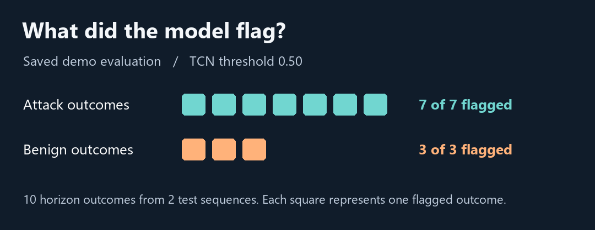

# NETRA — Network Threat Early-warning & Risk Analytics
NETRA is a network traffic analysis prototype for Smart India Hackathon problem statement SIH26153. Import traffic flows, inspect risk forecasts, and follow alerts into an incident queue.

**Try the sample.** Upload [the 120-flow synthetic CSV](datasets/DEMO_UPLOAD_ATTACK.csv) under **Add Demo Data → Upload Traffic Dataset**. With PostgreSQL connected, expect 120 valid rows and zero rejected rows. Select **Model A (Deterministic Baseline)** and six steps, then open **Start Here** to inspect the forecast. [Demo notes](datasets/DEMO_UPLOAD_README.md)

**Read the results.** The historical ML evaluation covers two held-out sequences from 16 input rows. The TCN flagged all ten evaluated horizon outcomes, including three benign ones. The current split checks require a larger capture for retraining. [Evaluation and confusion matrices](docs/STAGE5_EVALUATION.md)

---



## Architecture Overview

NETRA is a local cybersecurity intelligence and predictive threat forecasting platform built with:
- **Backend:** Java 21 / 25, Spring Boot 3.4.1, Spring Security, Spring Data JPA, STOMP WebSocket.
- **Authoritative Database:** PostgreSQL 16+ with versioned Flyway migrations (`V1`–`V4`).
- **Frontend:** React 19, Vite 8, TypeScript, Lucide Icons, Glassmorphism Dark SOC theme.
- **Machine Learning Engine:** Python FastAPI with PyTorch (TCN / LSTM architectures).

---

## Quick Start Guide

### 1. Prerequisites Check
Use JDK 21 or later, Node.js 24, Python 3.11 and PostgreSQL 16 or later. Set JAVA_HOME to your installed JDK.
```powershell
java -version
node -v
npm -v
```

### 2. PostgreSQL Database Setup
In the PowerShell session you will use for the backend, enter the password for your local PostgreSQL account. The setup script uses this account to create the demo database.
```powershell
$env:SPRING_DATASOURCE_PASSWORD = [System.Net.NetworkCredential]::new('', (Read-Host 'Local PostgreSQL password' -AsSecureString)).Password
.\scripts\setup-postgres.ps1
```
*Note: If PostgreSQL is not yet running, the backend will still start in resilient standby mode without crashing.*

### 3. Start the ML Forecasting Service
In a separate terminal:
```powershell
cd ml-service
py -3.11 -m venv .venv
.\.venv\Scripts\python.exe -m pip install -r requirements.txt
.\.venv\Scripts\python.exe -m uvicorn main:app --host 127.0.0.1 --port 8000
```
Confirm it is ready at `http://localhost:8000/health`.

### 4. Start Spring Boot Backend
From the repository root:
```powershell
cd backend
.\mvnw.cmd spring-boot:run
```
The demo API allows unauthenticated local requests. Keep it on loopback. The backend starts at `http://localhost:8080`.
- Health Endpoint: `http://localhost:8080/api/health`
- Dashboard API: `http://localhost:8080/api/dashboard/summary`
- Actuator: `http://localhost:8080/actuator/health`

### 5. Start React Frontend
In a separate terminal:
```powershell
cd frontend
npm.cmd ci
npm.cmd run dev
```
Open `http://localhost:5173` in your browser to access the NETRA Command Centre.

### 6. Running Tests
To run backend unit tests:
```powershell
cd backend
.\mvnw.cmd test
```
To run frontend type-check & build:
```powershell
cd frontend
npm.cmd run build
```
To run the Python ML checks:
```powershell
cd ml-service
.\.venv\Scripts\pytest.exe tests/test_ml_service.py
```

## Current Verification

The full local stack has been verified with PostgreSQL persistence enabled: Flyway migrations V1–V4, the Java backend, the React build, and the ML service health endpoint all pass. See [docs/FINAL_VERIFICATION.md](docs/FINAL_VERIFICATION.md) for the current verification record and known academic limitations.
