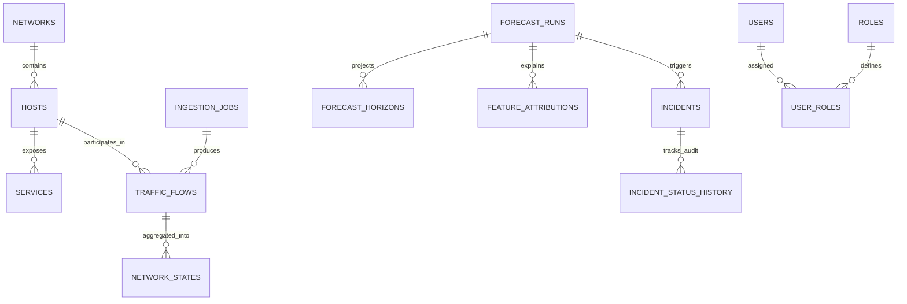
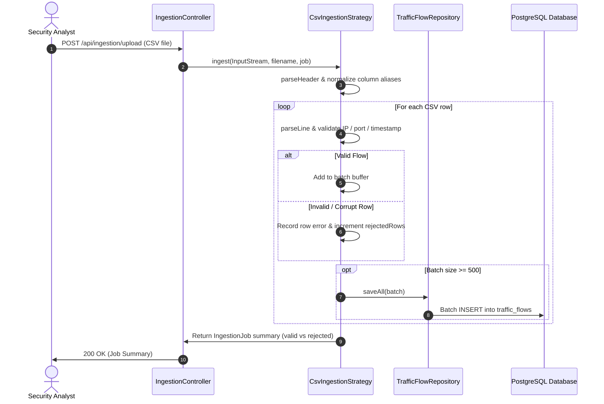
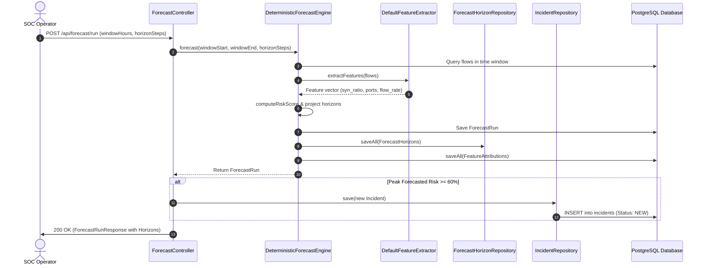
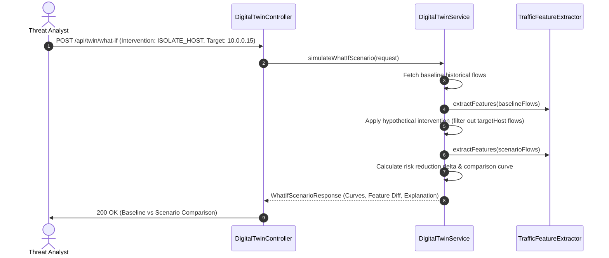
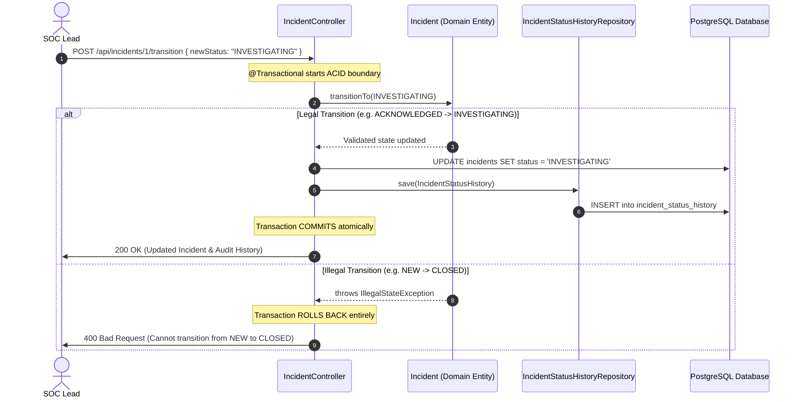

# NETRA — Java Architecture & Academic DBMS Specification

---

## 1. Object-Oriented Programming (OOP) Principles Implementation

### A. Encapsulation & Domain Invariants
- **Private Fields & Strong Accessors:** All domain entities (`User`, `Incident`, `ForecastRun`, `TrafficFlow`, `Host`) enforce strict field privacy.
- **Entity State Machine:** `Incident.transitionTo(newStatus)` enforces lifecycle state invariants inside the domain entity rather than leaking state mutation logic into controllers.

### B. Abstraction & Pluggable Interfaces
- **`NetworkForecastEngine`:** Interface defining `ForecastRun forecast(...)`. Decouples forecasting algorithms so `DeterministicForecastEngine` can operate today and a future Python PyTorch TCN model can plug in tomorrow without changing controllers or UI.
- **`TrafficIngestionStrategy`:** Interface defining multi-format ingestion (`CsvIngestionStrategy`, `PcapIngestionStrategy`, `SyntheticTrafficGenerator`).
- **`TrafficFeatureExtractor`:** Interface defining mathematical feature calculation over collections of flows.

### C. Polymorphism & Strategy Pattern
- `TrafficIngestionStrategy` demonstrates runtime polymorphism: the system selects the appropriate parsing algorithm based on file MIME type / extension (`.csv`, `.pcap`, `.sim`).

### D. Composition over Inheritance
- `Host` has a relationship to `Network` (`@ManyToOne`).
- `ForecastRun` has-many `ForecastHorizon` records and has-many `FeatureAttribution` records (`@OneToMany`).
- `Incident` aggregates evidence objects, linked forecast runs, and assigned hosts.

---

## 2. Mermaid Architecture & Sequence Diagrams

### Diagram 1: Entity Relationship Diagram (ERD)

### Diagram 2: Traffic Ingestion Sequence

### Diagram 3: Forecast Generation & Automated Escalation Sequence

### Diagram 4: What-If Defensive Counterfactual Simulation Sequence

### Diagram 5: Atomic Incident State Transition

